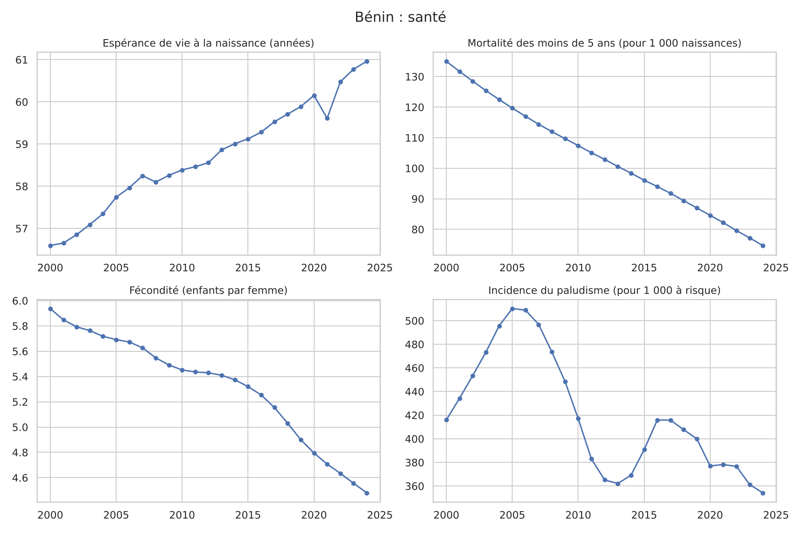
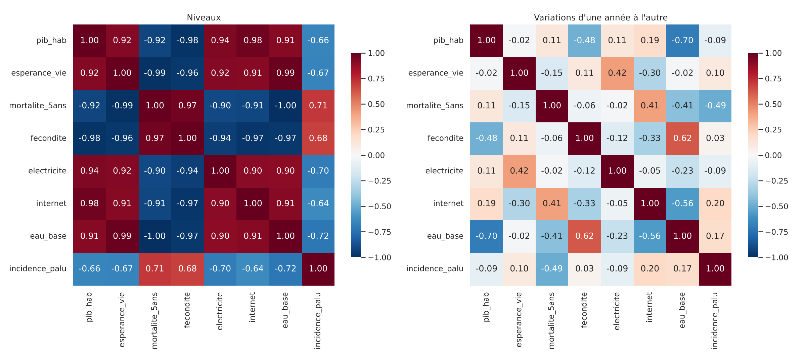
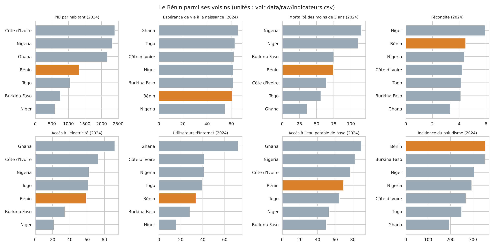

# Analyse exploratoire des données socio-économiques du Bénin

Évolution de 15 indicateurs publics de 2000 à 2024, et comparaison avec le Togo, le Nigeria, le Niger,
le Burkina Faso, le Ghana et la Côte d'Ivoire.

## Données
- **Source :** World Development Indicators (Banque mondiale), qui compile aussi des données d'autres organismes.
- **Accès :** miroir public [open-numbers/ddf--world_bank--world_development_indicators](https://github.com/open-numbers/ddf--world_bank--world_development_indicators),
  commit `4252d91` (14 octobre 2026), consulté le 26 novembre 2026.
- `data/raw/wdi_afrique_ouest.csv` : 5 176 observations (format long, toutes les années disponibles). Les valeurs ne sont pas modifiées ;
  l'extraction filtre pays et indicateurs, renomme les colonnes et ajoute les noms des pays.
- `data/raw/indicateurs.csv` : codes officiels, libellés et thèmes.
- Attribution : Banque mondiale, World Development Indicators (en général sous CC BY 4.0 ;
  vérifiez les conditions propres à chaque indicateur sur le site de la Banque mondiale).

## Démarche
1. Contrôle des doublons, des codes inconnus et de certains pourcentages hors de [0, 100].
2. Passage au format large sur une grille complète pays × année, pour rendre les manques visibles.
3. **Aucune imputation** : une valeur absente reste vide.
4. Statistiques descriptives, évolutions et pente linéaire (au moins 5 observations).
5. Corrélations sur les niveaux **et** sur les variations annuelles.
6. Comparaison régionale à la dernière année disponible pour les 7 pays.

## Principaux résultats (Bénin)
| Indicateur | 2000 | 2024 |
|---|---|---|
| Population (millions) | 7,22 | 14,46 |
| PIB par habitant (US$ constants) | 861 | 1 325 |
| Espérance de vie (années) | 56,6 | 61,0 |
| Mortalité des moins de 5 ans (‰) | 135,0 | 74,7 |
| Fécondité (enfants par femme) | 5,94 | 4,48 |
| Accès à l'électricité (%) | 21,5 | 59,0 |
| Utilisateurs d'Internet (%) | 0,2 | 34,0 |
| Incidence du paludisme (pour 1 000 à risque) | 416 | 354 |

- **Données manquantes :** de 2000 à 2024, l'alphabétisation manque 18 années sur 25 et l'achèvement du primaire 8 sur 25.
  Les 13 autres indicateurs sont complets.
- **Corrélations trompeuses :** le PIB par habitant et l'espérance de vie ont une corrélation de 0,92 en niveaux,
  mais de -0,02 sur les variations annuelles. Des séries qui ont une tendance dans le temps peuvent être très corrélées
  sans lien direct entre elles. Aucune de ces corrélations ne prouve une causalité.
- **Région (2024) :** parmi les 7 pays, le Bénin a l'incidence du paludisme la plus élevée
  (354,25, très proche du Burkina Faso avec 353,49).





## Limites
- Plusieurs indicateurs sont des estimations modélisées ou interpolées par les organismes sources ;
  des courbes très régulières ne signifient pas une mesure précise chaque année.
- « Aucune imputation » concerne ce projet, pas les traitements faits en amont par les sources.
- Les variations brusques (par exemple l'électricité en 2022) sont à vérifier dans les métadonnées avant interprétation.
- La pente linéaire résume mal les séries non linéaires, comme l'incidence du paludisme.
- Les corrélations reposent sur au plus 25 points.

## Utilisation
```bash
pip install -r requirements.txt
python src/analyse.py
python -m unittest discover -s tests
```

## Structure
```
data/raw/        données extraites
data/processed/  données au format large (générées)
src/             analyse
scripts/         reconstruction des données brutes
tests/           tests unitaires
outputs/         tableaux et graphiques
```
